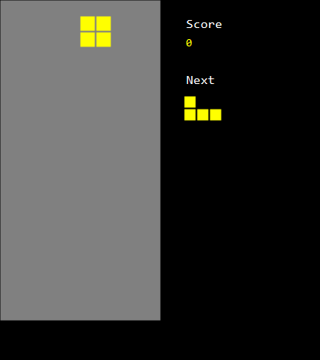

# Pseudo.NET

**Écrivez votre pseudocode avec vos propres mots. Obtenez un programme qui s'exécute.**

Pseudo.NET compile du pseudocode *libre* en C# grâce à un modèle de langage **local** ([Ollama](https://ollama.com)).
Aucune syntaxe n'est imposée : écrivez en français, anglais, espagnol, chinois… avec des accolades, avec de la
seule indentation, ou en phrases. Pas de compte, pas de clé d'API, rien ne quitte votre machine.

[English](README.md) · [Marketplace](https://marketplace.visualstudio.com/items?itemName=pseudonet-lang.pseudonet) · [Site](https://pseudonet-lang.github.io/fr/) · [Soutenir le projet](#soutenir)



## À quoi ça ressemble

```text
On veut trouver tous les nombres premiers jusqu'à 50.

nombresPremiers = une nouvelle liste

définir est-ce que compteur est premier, qui retourne un booléen
	estPremier = vrai
	si compteur est inférieur à 2 alors
		estPremier = faux
	répéter diviseur de 2 à 50
		si diviseur est inférieur à compteur alors
			reste = compteur modulo diviseur
			si reste est égal à 0 alors
				estPremier = faux
	retourner estPremier

répéter compteur de 2 à 50
	premier = est-ce que compteur est premier
	si premier alors
		ajouter compteur à nombresPremiers

afficher le texte "Nombres premiers jusqu'à 50 :"
pour chaque nombre dans nombresPremiers
	afficher nombre
```

Ici, seule l'indentation délimite les blocs : ni accolade, ni « fin si ».

## Deux types de projet

| Modèle | Produit | Idéal pour |
|---|---|---|
| **PseudoCode** | application Console | algorithmique, enseignement, exercices |
| **PseudrawCode** | fenêtre (WinForms) : dessin, clavier, minuterie | petits jeux, animations |

Six exemples prêts à lancer sont fournis comme modèles de projet : **Snake, Tetris, Balle rebondissante, Nombres
premiers, Tri à bulles, Devine le nombre** (en anglais dans le paquet). Ils embarquent leur réponse pré-calculée : le
*premier lancement n'exige pas Ollama*.

## Pourquoi

Les agents écrivent du code, mais il faut toujours apprendre à *raisonner* algorithmiquement. Le pseudocode est la
méthode classique pour l'enseigner, mais il n'a jamais été exécutable. Pseudo.NET le rend exécutable sans lui retirer
sa liberté, et le C# généré est un vrai programme que l'élève peut ensuite ouvrir et lire.

## Installation

1. Installez **Visual Studio 2026** (Community suffit). Visual Studio 2022 est visé mais pas encore testé.
2. Installez **[Ollama](https://ollama.com)** puis téléchargez le modèle une fois (environ 5 Go) :
   ```bash
   ollama pull qwen2.5-coder:7b
   ```
3. Installez l'extension depuis le **[Marketplace de Visual Studio](https://marketplace.visualstudio.com/items?itemName=pseudonet-lang.pseudonet)**, ou directement dans Visual Studio :
   *Extensions → Gérer les extensions* → cherchez **Pseudo.NET** → *Installer*. (Sinon, téléchargez
   `PseudoNet.Vsix.vsix` depuis la page [Releases](../../releases) et double-cliquez dessus.)
4. *Fichier → Nouveau → Projet* → cherchez **Pseudo** → *PseudoCode*, *PseudrawCode* ou un exemple. **F5**.

### Ou en ligne de commande (tout éditeur, SDK .NET 8+)

```bash
dotnet new install PseudoNet.Templates
dotnet new pseudocode -n Bonjour
cd Bonjour
dotnet run
```

Noms courts : `pseudocode`, `pseudrawcode` (Windows), et les exemples `pseudo-snake`, `pseudo-tetris`, `pseudo-bounce`,
`pseudo-primes`, `pseudo-bubble-sort`, `pseudo-guess-number`.

## Fonctionnement

```
.pseudo → LLM local → AST JSON → validation / réparation → C# → build .NET habituel
```

- Les réponses sont **mises en cache** (par empreinte du pseudocode) : un programme inchangé n'appelle plus le modèle.
- L'AST est validé ; si le modèle se trompe, le compilateur lui demande de se corriger (2 tours max), sinon il avertit.
- Les noms de couleurs et de touches (`rouge`, `gauche`, `红色`…) sont dans des tables JSON par langue : ajouter la
  vôtre revient à écrire un fichier.

## Limites assumées

- Un modèle local de 7 milliards de paramètres est bon, pas parfait : un programme très long ou ambigu peut demander
  une reformulation.
- Windows et Visual Studio uniquement pour l'instant.
- La première génération d'un *nouveau* programme prend de quelques secondes à quelques minutes selon la machine.

## Votre avis

Questions, idées, programmes qui échouent ou que vous aimeriez en exemple : [ouvrez une discussion](https://github.com/pseudonet-lang/pseudonet/discussions) (en français ou en anglais).

## Soutenir

Pseudo.NET est gratuit, sous licence MIT, et le restera. Si l'outil vous a servi, à vous ou à vos élèves, et que vous
souhaitez remercier pour l'idée, un don volontaire est le bienvenu, jamais obligatoire :

**[Soutenir sur Ko-fi](https://ko-fi.com/pseudonetlang)** (PayPal ou carte)

Les étoiles, rapports de bugs, tables de langues et programmes d'exemple aident tout autant.

## Licence

[MIT](LICENSE.txt) © 2026 Malek AIT OUARET
